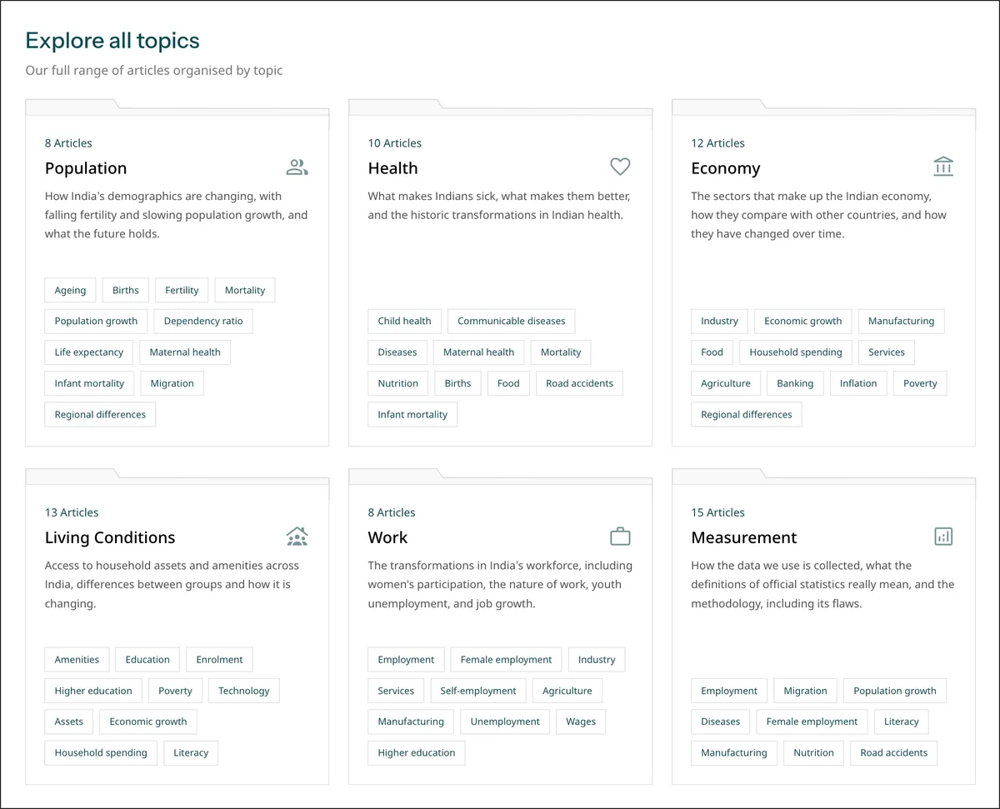

# the **reference**,<br>every element this site can render.

## about this page

This page shows every element the site can render, and how to write each one. It is both a reference and a test: everything below is drawn by the same code that builds the case studies, so if something looks wrong here, it looks wrong there too.

All copy lives in `content/*.md` files. There is no markdown library: each part of the site reads its own small format, listed below. Edits show up after `python3 build.py`.

For fonts, colours, spacing and components, see the [style](/style/) page.

## inline text

Text can be **bold** or *italic*. Links look like [this](https://thedataareclean.com) and open in a new tab, while links to a page on this site, like the [style](/style/) page, open in the same one. File names and keys are written as `inline code`.

```
Text can be **bold** or *italic*.
Links look like [this](https://thedataareclean.com).
Links to a page on this site, like the [style](/style/) page, open in the same tab.
File names and keys are written as `inline code`.
```

Bold, italic and links work in case study paragraphs and lists, team lists and the footer. Everywhere else, text is shown as written.

## accent words

In headings and taglines, `**bold**` turns a word the accent colour instead of making it bold, like the heading at the top of this page. A `<br>` forces a line break.

```
# hello, i am **arpit** !
during **play**,<br>i do **whatever i want**.
# **toolkit** at work
```

This works in the hero, the page intros, every section title and the `heading` lines in `meta.md`, which are also drawn on the share images.

## headings

Each `##` heading starts a section, shown as a small accent label like the ones on this page. A `###` heading is a sub-heading inside it.

### this is a sub-heading

The smallest heading level in a file becomes the section level, and one level deeper becomes a sub-heading. A section with nothing in it is skipped.

```
## what i did

### research
```

## paragraphs

Every line is its own paragraph.

Blank lines between them are optional and ignored, so a paragraph can't wrap across lines in the file.

```
Every line is its own paragraph.

Blank lines between them are optional and ignored.
```

## lists

- Bullets start with a dash and a space.
- Numbered items render the same way, so order is shown by position, not numbers.
- A list can sit between paragraphs, and a section with nothing but a list (like **team**) renders as one list.

```
- Bullets start with a dash and a space.
1. Numbered items render the same way.
```

## images

An image sits on its own line. The text in the brackets is its caption and alt text; leave it empty for no caption.



```

```

Two images in a row stack flush, with no gap between them. Images live in `assets/` and must be WebP: run `python3 build.py --optimize-images` after adding a PNG or JPG. The build warns about any case study image it can't find.

## code

Code blocks are wrapped in a line of three backticks above and below. They keep their spacing and scroll sideways instead of wrapping.

```
python3 build.py
python3 build.py --optimize-images
python3 build.py --gen-monthly
```

## comments

Anything between `<!--` and `-->` is hidden. Case studies use comments to label their parts, and the rolodex uses them to name categories.

```
<!-- CARD -->
```

## case studies

Each project is one file in `content/work/projects/`. The lines before the first `##` heading fill the project card and the top of its page; everything after is the case study, written with the elements above.

```
<!-- CARD -->
- problem: How do you measure which interventions work?
- org: Udhyam Vyapaar
- year: 2022–2024
- tags: monitoring & evaluation, product, impact

<!-- IDENTITY -->
- url: https://www.udhyam.org/vyapaar
- slug: vyapaar-mne
- added: Apr 2026

<!-- CASE STUDY -->
## overview
Udhyam Vyapaar works with nano-entrepreneurs across India.

## team
- Arpit Arora, Senior Manager, Monitoring and Evaluation
```

- **problem** is the heading on the card, the page and the share image.
- **org** and **year** sit under it. A project with no org is skipped.
- **slug** is the page address, `/work/<slug>/`. Without one, it's made from the org.
- **added** dates the project in the RSS feed.
- Card order is set in `content/work/project-order.md`, one slug per line. Projects not listed go last.

## articles

Published writing lives in `content/work/articles.md`, newest first. The first six show, and a button reveals the rest.

```
## Visualising data for social development
- publisher: infogr8
- date: Apr 2024
- tags: data viz, social impact, interview
- url: https://infogr8.com/arpit-arora-on-visualising-data-for-social-development/
```

## playground

Each playground card is one line in `content/play/playground.md`: a link, an image from `assets/playground/`, a one-line description, and an optional year, split by `|`.

```
[musings](https://musings.thedataareclean.com) | musings.webp | a place for my thoughts and ideas. | 2026
```

## lately

`content/play/lately.md` holds one line per activity. A link makes the row clickable, plain text shows it unlinked, and an empty value hides the row.

```
- read: [The Once and Future Riot](https://www.goodreads.com/book/show/222376500)
- listened: Decoder, The Verge
- watched:
```

The keys are read, listened, watched, cooked, explored, played, built, learned, ran, cycled, photographed, brewed, visited and wrote. Each one's icon is fixed, and the verb shown beside it is set in `labels.md`. Changed rows are logged to `lately-archive.md` on every commit, which feeds the RSS feed.

## rolodex

`content/play/ideas.md` groups links into categories. A comment names each category and its icon, and one random link per category shows on each visit.

```
<!-- data & visualisation | bar_chart -->
- [Flowing Data](https://flowingdata.com)
- [Our World in Data](https://ourworldindata.org)
```

The icon must be one of the icons on the [style](/style/) page. A new one has to be added to `ICON_NAMES` in `build.py` first.

## tags

The toolkit (`content/work/toolkit.md`) and interests (`content/play/interests.md`) are plain lists, one tag per line. In interests, a line between the heading and the list becomes a subtitle.

```
# **other** things
i am curious about, in no particular order.

- walking
- squirrels
```

## site text

- `content/hero.md` is the home page heading and tagline.
- `content/work/intro.md` and `content/play/intro.md` are the opening lines of work and play.
- `content/meta.md` sets each page's title, description and share image text.
- `content/footer.md` is the footer.
- `content/labels.md` holds every button, label and screen reader text. Its keys are fixed; only the values change.

## this page and style

This page is `content/reference.md`, written with the elements above. The [style](/style/) page is `content/style.md`, where a comment like `<!-- type | sample text -->` inserts a generated block, such as the type scale, with the lines below it as notes. Its values are read from `style.css` and `build.py` at build time.
